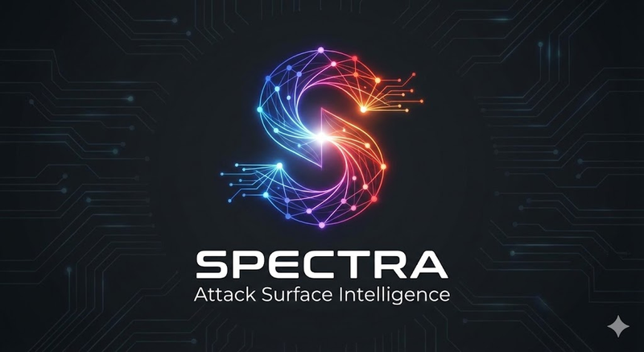

<p align="center">
  
</p>

<h1 align="center">SPECTRA</h1>

<p align="center">
  AI-powered attack surface reconnaissance tool. Scans targets for subdomains, open ports, services, and known vulnerabilities, stores everything in a Neo4j graph database, and provides an AI analyst that reasons over the graph to answer security questions.
</p>

<p align="center">
  Built as a learning project to understand how red team recon tools work end-to-end.
</p>

<p align="center">
  <em>Scope note: Spectra is AI-assisted reconnaissance of networks and web assets. It uses an LLM to analyse scan results; it does not red-team AI models.</em>
</p>

<p align="center">
  <a href="https://github.com/infantesromeroadrian/Spectra-Attack-Surface-Recon/actions/workflows/ci.yml"></a>
  
  
  
  
  
</p>

---

## Architecture

```
                         +------------------+
                         |    Webapp :8000   |
                         |  FastAPI + JS UI  |
                         +--------+---------+
                                  |
                    +-------------+-------------+
                    |                           |
             +------+------+           +-------+-------+
             |  AI Agent   |           |  Recon Engine  |
             |  LangGraph  |           |  nmap + DNS +  |
             |  + Groq LLM |           |  crt.sh + NVD  |
             +------+------+           +-------+-------+
                    |                           |
                    +-------------+-------------+
                                  |
                         +--------+--------+
                         |   Neo4j :7474   |
                         |  Graph Database |
                         +-----------------+
```

**Four modules, one pipeline:**

| Module | What it does |
|--------|-------------|
| **Recon** | Discovers subdomains, resolves DNS, scans ports with nmap, fingerprints technologies, queries NVD for CVEs |
| **Graph** | Stores all findings in Neo4j as an interconnected graph (Domain -> Host -> Port -> Service -> Vulnerability) |
| **Agent** | LangGraph ReAct agent with 5 tools that queries Neo4j to answer security questions via Groq LLM (Llama 3.3 70B) |
| **Webapp** | FastAPI backend + vanilla JS frontend with dashboard, force-directed graph visualization, scan launcher, and AI chat |

---

## Quick Start

### Prerequisites

- Docker and Docker Compose
- A [Groq API key](https://console.groq.com/) (free tier works)

### 1. Clone and configure

```bash
git clone https://github.com/infantesromeroadrian/Spectra-Attack-Surface-Recon.git
cd Spectra-Attack-Surface-Recon
```

Create a `.env` file in the project root:

```env
GROQ_API_KEY=gsk_your_groq_api_key_here
# Optional: Neo4j password (defaults to spectrapass)
NEO4J_PASSWORD=change-me
```

### 2. Build and run

```bash
docker compose build
docker compose up -d
```

This starts **Neo4j** (graph database) and the **Webapp** (dashboard + AI agent).

### 3. Open the UI

- **Dashboard:** http://localhost:8000
- **Neo4j Browser:** http://localhost:7474 (user: `neo4j`, password: `NEO4J_PASSWORD`, default `spectrapass`)
- **API Docs:** http://localhost:8000/docs

### 4. Run your first scan

Either use the **Scan** tab in the UI, or from the command line:

```bash
docker compose run --rm recon
```

By default it scans `scanme.nmap.org`. Override with environment variables:

```bash
SCAN_TARGET=example.com SCAN_PROFILE=full docker compose run --rm recon
```

---

## Scan Profiles

| Profile | Ports | Version Detection | Scripts | Use Case |
|---------|-------|-------------------|---------|----------|
| `quick` | Top 100 | No | No | Fast overview |
| `standard` | Top 1000 | Yes | No | Default, good balance |
| `full` | All 65535 | Yes | Yes | Deep audit |

---

## Recon Pipeline

The scan runs 6 phases sequentially:

```
Phase 1: Subdomain Discovery    crt.sh + DNS brute force (with wildcard detection)
Phase 2: DNS Resolution         A, AAAA, MX, NS, TXT, CNAME records
Phase 3: Port Scanning          nmap with selected profile
Phase 4: Tech Fingerprinting    ~50 signatures (Apache, nginx, React, WordPress, etc.)
Phase 5: Vulnerability Assessment   Known vulns DB + NVD API v2 (CPE matching)
Phase 6: Graph Ingestion        MERGE into Neo4j (idempotent)
```

---

## Graph Schema

```
(Scan)-[:SCANNED]->(Domain)
(Domain)-[:HAS_SUBDOMAIN]->(Subdomain)
(Domain)-[:RESOLVES_TO]->(Host)
(Subdomain)-[:RESOLVES_TO]->(Host)
(Host)-[:HAS_PORT]->(Port)
(Port)-[:RUNS]->(Service)
(Service)-[:HAS_VULN]->(Vulnerability)
(Vulnerability)-[:AFFECTS]->(Host)
(Domain)-[:USES_TECH]->(Technology)
```

7 node types, 9 relationship types. All ingestion uses `MERGE` for idempotency -- re-scanning the same target updates existing nodes rather than creating duplicates.

---

## AI Agent

The agent uses the **ReAct pattern** (Reason + Act) via LangGraph:

1. Receives a user question
2. Decides which tools to call (or responds directly)
3. Executes Neo4j queries via tools
4. Loops until it has enough information to answer
5. Responds with actionable security insights

### Tools

| Tool | Purpose |
|------|---------|
| `get_attack_surface` | High-level summary of the entire graph |
| `find_vulns` | Search vulnerabilities by severity/score |
| `find_attack_paths` | Trace Domain -> Host -> Port -> Service -> CVE chains |
| `get_host_details` | All info about a specific IP address |
| `run_cypher` | Free-form Cypher queries, read-only (see [Security notes](#security-notes)) |

### Multi-turn Memory

The agent maintains conversation context using LangGraph's `MemorySaver` checkpointer. Each browser session gets a unique `thread_id` -- the agent remembers previous messages within the same session. Click **"New Chat"** to start a fresh conversation.

---

## Webapp

Four tabs in the UI:

| Tab | Features |
|-----|----------|
| **Dashboard** | Stat cards, host list with ports, vulnerability table with severity filter, attack path visualization |
| **Graph** | Interactive force-directed graph (force-graph library). Color-coded by node type. Zoom, pan, hover labels |
| **Scan** | Target input, profile selector, real-time progress polling |
| **AI Analyst** | Chat with the LangGraph agent. Preset suggestion buttons. Multi-turn memory. Tool call transparency |

### API Endpoints

| Method | Endpoint | Description |
|--------|----------|-------------|
| GET | `/api/health` | Health check (Neo4j + agent status) |
| GET | `/api/graph/stats` | Node counts by type |
| GET | `/api/graph/hosts` | Hosts with ports and vuln counts |
| GET | `/api/graph/vulns` | Vulnerabilities (filterable by severity) |
| GET | `/api/graph/paths` | Attack paths (Domain -> CVE) |
| GET | `/api/graph/visual` | Graph data for force-directed visualization |
| POST | `/api/chat` | Send message to AI agent |
| POST | `/api/scan/start` | Launch a recon scan |
| GET | `/api/scan/status` | Poll scan progress |

---

## Project Structure

```
spectra/
├── recon/                      # Phase 1: Reconnaissance engine
│   ├── models.py               #   Pydantic models (Host, Port, Service, Vulnerability...)
│   ├── dns_resolver.py         #   DNS resolution (A, AAAA, MX, NS, TXT, CNAME)
│   ├── subdomain_discovery.py  #   crt.sh + brute force + wildcard detection
│   ├── port_scanner.py         #   nmap wrapper with scan profiles
│   ├── tech_fingerprint.py     #   HTTP header/body signature matching
│   ├── vuln_assessment.py      #   Known vulns DB + NVD API v2
│   ├── main.py                 #   Pipeline orchestrator (6 phases)
│   └── Dockerfile
│
├── graph/                      # Phase 2: Neo4j integration
│   ├── client.py               #   GraphClient (connect, schema, stats, wipe)
│   ├── ingest.py               #   GraphIngestor (MERGE-based idempotent ingestion)
│   └── __init__.py
│
├── agent/                      # Phase 3: AI Agent
│   ├── tools.py                #   5 @tool functions for Neo4j queries
│   ├── graph.py                #   LangGraph StateGraph (ReAct loop + MemorySaver)
│   ├── main.py                 #   Interactive CLI chat loop
│   └── Dockerfile
│
├── webapp/                     # Phase 4: Web application
│   ├── app.py                  #   FastAPI factory with lifespan pattern
│   ├── routes/
│   │   ├── graph_api.py        #   7 graph data endpoints
│   │   ├── chat_api.py         #   AI chat endpoint (multi-turn)
│   │   └── scan_api.py         #   Scan launcher + polling
│   ├── static/
│   │   ├── index.html          #   SPA with 4 tabs
│   │   ├── style.css           #   Dark cybersecurity theme
│   │   └── app.js              #   Vanilla JS (API calls, rendering, events)
│   └── Dockerfile
│
├── tests/                      # Unit tests (no network, nmap or Neo4j needed)
├── .github/workflows/ci.yml    # Lint + tests on every push and PR
├── docker-compose.yml          # 4 services (neo4j, webapp, recon, agent)
├── pyproject.toml              # Dependencies managed with uv
├── LICENSE                     # MIT
├── .env                        # Secrets (not committed)
└── .gitignore
```

---

## Docker Services

| Service | Type | Port | Description |
|---------|------|------|-------------|
| `neo4j` | Permanent | 7474, 7687 | Graph database with APOC plugin |
| `webapp` | Permanent | 8000 | Dashboard + API + AI agent |
| `recon` | On-demand | -- | Runs scan and exits |
| `agent` | On-demand | -- | Interactive CLI chat |

```bash
# Start persistent services
docker compose up -d

# Run a scan (on-demand, exits when done)
docker compose run --rm recon

# Interactive CLI chat (on-demand)
docker compose run --rm agent

# Stop everything
docker compose down

# Rebuild after code changes
docker compose build && docker compose up -d
```

---

## Tech Stack

| Component | Technology |
|-----------|-----------|
| Language | Python 3.11 |
| Package Manager | uv |
| Web Framework | FastAPI + Uvicorn |
| Graph Database | Neo4j 5 Community + APOC |
| AI Framework | LangGraph + LangChain |
| LLM Provider | Groq (Llama 3.3 70B Versatile) |
| Port Scanner | nmap (via python-nmap) |
| DNS | dnspython |
| HTTP Client | httpx |
| Data Validation | Pydantic v2 |
| Frontend | Vanilla JS + force-graph |
| Containerization | Docker + Docker Compose |

---

## Security Notes

The agent reads data that comes from the scanned target: service banners, DNS TXT records, HTML. That data can carry injected instructions, so every query the LLM writes is treated as untrusted input.

- **Read-only agent.** All agent tools run inside Neo4j read transactions. `run_cypher` adds two barriers before that: a deny-list of write and escape clauses (`CREATE`, `MERGE`, `SET`, `DELETE`, `CALL`, `LOAD CSV`, ...) matched as whole words, and an `EXPLAIN` check that only accepts queries Neo4j itself classifies as read (`r`). `CALL` is blocked entirely because read-mode APOC procedures such as `apoc.load.json` can still make HTTP requests or read files.
- **Local only.** Docker Compose publishes the webapp and Neo4j on `127.0.0.1`. The webapp has no authentication and can launch scans; exposing it on a network would let anyone use the host as a scanner.
- **Known limit.** Neo4j Community Edition has no read-only roles. For a shared deployment, give the agent a database user with the Enterprise `reader` role instead of relying on application-level checks.

---

## Development

```bash
uv sync --group dev
uv run ruff check .
uv run pytest
```

The unit tests cover the data models, CPE conversion and NVD parsing, technology fingerprinting, wildcard filtering, and the agent's read-only guards. They need no network, nmap or Neo4j; CI runs them on every push and pull request.

---

## License

[MIT](LICENSE)

---

## Disclaimer

This tool is for **authorized security testing and educational purposes only**. Only scan targets you have explicit permission to test. The author is not responsible for misuse.
